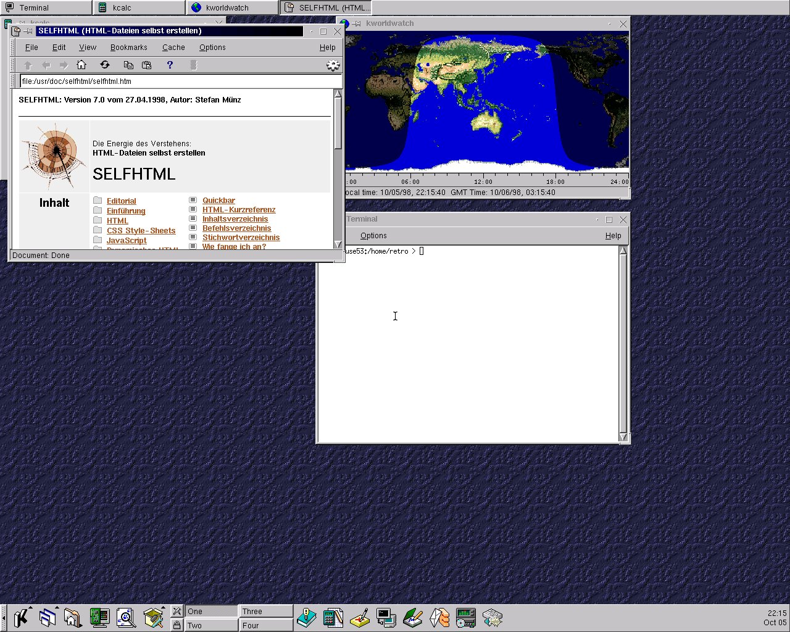

# xf86vesa — a VESA (VBE 2.0) driver for XFree86 3.3.2

*[Español abajo](#español)*

A «non-picky» X for 1998 Linux: **no modelines, no clocks, no monitor frequencies**. The driver asks the video
BIOS which modes it has (VBE `4F00`/`4F01`) and sets them with the same BIOS (`4F02`, linear framebuffer), like DOS
games did. The BIOS is called in real mode through Linux 2.0's `vm86()` system call, with a tiny LRMI-style layer
that emulates the BIOS's IN/OUT instructions.

Written in 2026 for **SuSE Linux 5.3** (kernel 2.0.35, XFree86 3.3.2.3, libc5) by the retroblog.
Full story: [KDE 1.0 on SuSE Linux 5.3](https://www.canaldelasrecetas.com/cms/retro-suse53-kde1-en/) ·
[A VESA driver for XFree86 3.3.2](https://www.canaldelasrecetas.com/cms/retro-suse53-driver-vesa-en/)



## The whole XF86Config

```
Section "Monitor"
    Identifier  "Any"
EndSection
Section "Device"
    Identifier  "VESA"
    Chipset     "vesa"
EndSection
Section "Screen"
    Driver "svga"  Device "VESA"  Monitor "Any"  DefaultColorDepth 16
    SubSection "Display"  Depth 16  EndSubSection
EndSection
```

Without `Modes` the driver uses one mode, the largest the BIOS offers up to 1280x1024 (no virtual screen, no
panning). With `Modes "1024x768" "800x600"` it uses those; Ctrl+Alt+Keypad-Plus cycles them. Depths 8/15/16/24/32.

## Contents

| Path | What |
|---|---|
| `xf86vesa-3.3.2.diff` | the patch for the XFree86 3.3.2 tree (`cd xc; patch -p1 < xf86vesa-3.3.2.diff`) |
| `src/vbe_rm.c`, `vbe_rm.h` | int 10h from Linux 2.0 via `vm86()` (syscall 113), IN/OUT/INS/OUTS emulation |
| `src/vesa_driver.c`, `Imakefile` | the `vesa` chipset driver for XF86_SVGA (`vga256/drivers/vesa`) |
| `src/vbeinfo.c` | lists the VBE modes of your card (`gcc -O2 -o vbeinfo vbeinfo.c vbe_rm.c`, run as root) |
| `src/vesaconfig` | switches X to the VESA server (`--deshacer` restores the previous setup) |
| `rpm/xf86vesa.spec` | RPM 2.4 spec (needs a built XFree86 3.3.2 tree in `/usr/src/packages/BUILD/xc`) |

Binary RPMs (`xf86vesa-1.0-1.i386.rpm`, `.src.rpm`) are in the GitHub release.

## Build

1. Prepare and build the XFree86 3.3.2 tree (on SuSE 5.3: `rpm -bp xf86.spec`, then `make World` in `xc`).
2. Apply the patch: it adds `programs/Xserver/hw/xfree86/vga256/drivers/vesa` and puts `vesa` before `generic` in
   `XF86SvgaDrivers` (`config/cf/xfree86.cf`).
3. In `programs/Xserver/hw/xfree86/vga256`: `make Makefile && make Makefiles && rm -f vga256Conf.c && make`, then
   in `programs/Xserver`: `make XF86_SVGA`. Install it as `XF86_VESA` (setuid root).

## Tested

- QEMU Cirrus Logic GD5446 and QEMU standard VGA (SeaBIOS VBE 3.0): 1280x1024x16, console switching both ways.
- Installed with YaST 0.97.2 from an «extras CD» (series `xsrv`).

## Limits and notes

- No 2D acceleration, no DPMS. Needs VBE 2.0+ with a linear framebuffer and an i386 Linux 2.0 with `vm86()`.
- Mode sets use bit 15 of `4F02` (do not clear video memory): XFree86 does not redraw on a mode switch.
- The emulated Cirrus BIOS implements `4F07` (display start) incorrectly; the driver warns about it in the log.

## Español

Un X «no quisquilloso» para el Linux de 1998: **sin modelines, sin relojes, sin frecuencias de monitor**. El driver
le pregunta al BIOS de video qué modos tiene y los pone con el mismo BIOS, como los juegos de DOS, llamándolo en modo
real con `vm86()` de Linux 2.0. Hecho en 2026 para **SuSE Linux 5.3** por el retroblog. Historia completa:
[KDE 1.0 en SuSE Linux 5.3](https://www.canaldelasrecetas.com/cms/retro-suse53-kde1-es/) ·
[Un driver VESA para XFree86 3.3.2](https://www.canaldelasrecetas.com/cms/retro-suse53-driver-vesa-es/).
Compilación, contenido y límites: ver arriba. Instalar el RPM: `rpm -i xf86vesa-1.0-1.i386.rpm` (o con YaST) y
`vesaconfig`; deshacer con `vesaconfig --deshacer`; ver los modos con `vbeinfo`.

## License

MIT/X11 style, like XFree86. See `LICENSE`.
