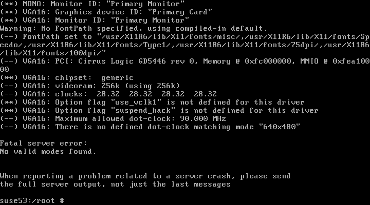
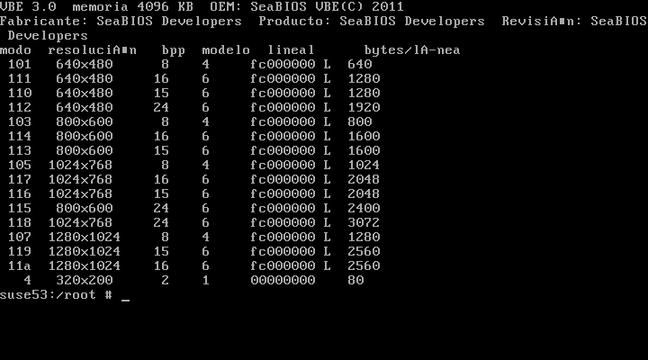
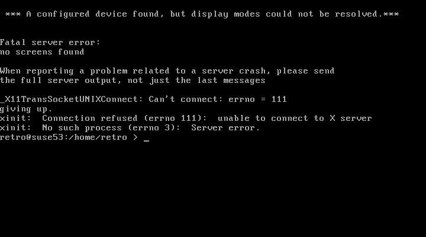
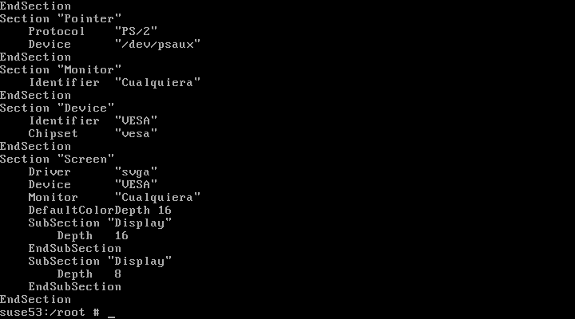
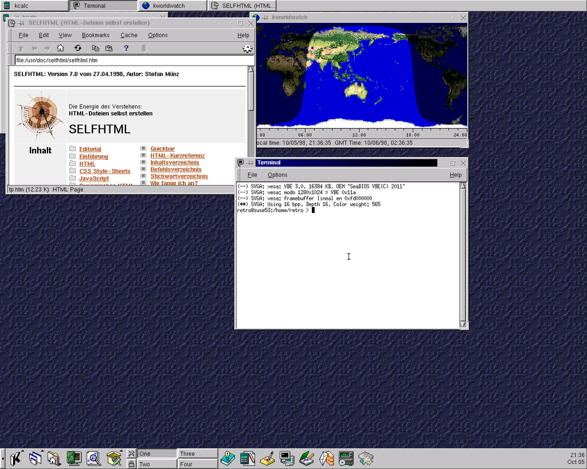
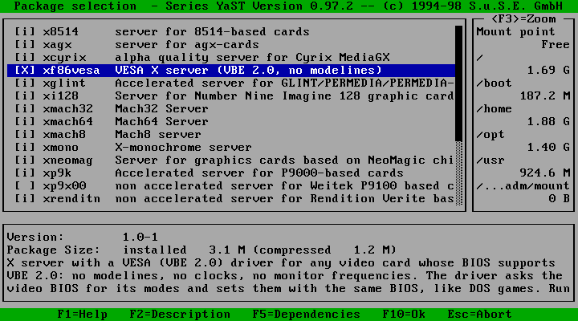
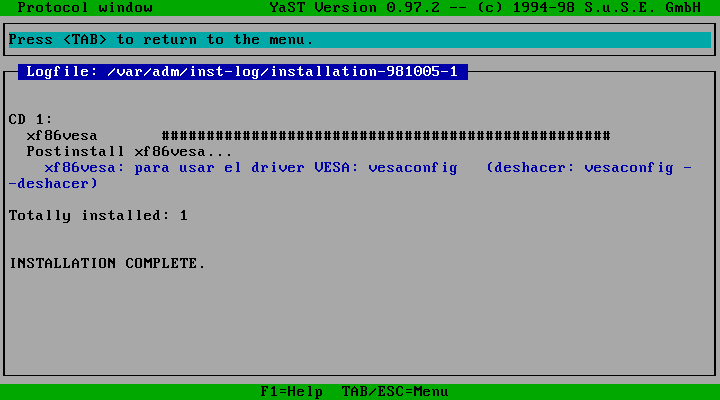
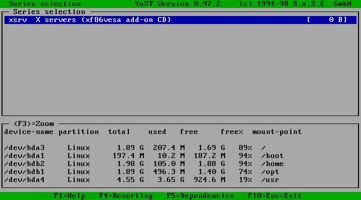
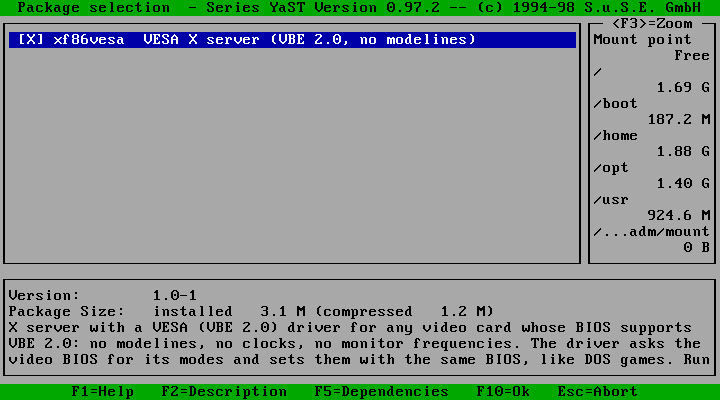
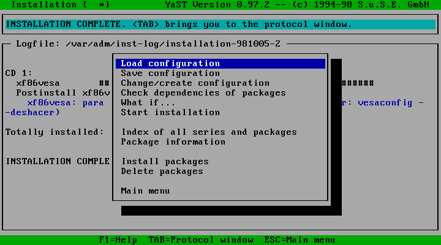

# xf86vesa

**A VESA (VBE 2.0) driver for XFree86 3.3.2 — X without modelines on 1998 Linux.**
Un driver VESA para XFree86 3.3.2: X sin modelines en el Linux de 1998.

[](../../releases/latest)

-green)


📖 The story: **[A VESA driver for XFree86 3.3.2](https://www.canaldelasrecetas.com/cms/retro-suse53-driver-vesa-en/)** ·
**[Un driver VESA para XFree86 3.3.2](https://www.canaldelasrecetas.com/cms/retro-suse53-driver-vesa-es/)** ·
previous chapter: [KDE 1.0 on SuSE Linux 5.3](https://www.canaldelasrecetas.com/cms/retro-suse53-kde1-en/)

📦 **Download:** `xf86vesa-1.0-1.i386.rpm`, `xf86vesa-1.0-1.src.rpm` the YaST add-on CD `xf86vesa-1.0-cd.iso` and the same on a 1.44 MB floppy `xf86vesa-1.0-floppy.img` in the [latest release](../../releases/latest).


## Before / after

| Before: XFree86 3.3.2 the 1998 way | After: the VESA driver |
|---|---|
|  |  |
| SaX measures every clock as 28.32 MHz: *No valid modes found* | `vbeinfo` asks the video BIOS for its VBE modes |
|  |  |
| Standard VGA without the driver: *no screens found* | The whole XF86Config: `Chipset "vesa"`, a monitor with just a name |
|  |  |
| First start: the grey weave at 1280x1024, on the first try | KDE 1.0 on QEMU's standard VGA, same binary, same file |

### Installed with YaST 0.97.2

| | |
|---|---|
|  |  |

## Add-on CD for YaST

`xf86vesa-1.0-cd.iso` (in the [release](../../releases/latest), 1.7 MB) is a CD that YaST 0.97 accepts as its
installation medium: it only lists `xf86vesa` in series `xsrv`. Attach it (or burn it), then `yast` →
*Choose/Install packages* → *Change/create configuration* → `xsrv` → mark `xf86vesa` → F10 → *Start installation*,
and finally `vesaconfig`. It has no SuSE files: [`cd/armar_cd.sh`](cd/armar_cd.sh) builds it from the RPM.
YaST checks three things on a medium: the package descriptions (`suse/setup/descr/*.pkd`), the series
descriptions (`*.ser`) and a disc marker (`/.S.u.S.E-disk-001`, or it says «Wrong CD»).

There is also a **1.44 MB floppy** version, `xf86vesa-1.0-floppy.img` (ext2 revision 0, readable by Linux 2.0; built by
[`cd/armar_floppy.sh`](cd/armar_floppy.sh)): `mount -t ext2 /dev/fd0 /mnt`, then in YaST pick the installation
source «directory» `/mnt`, or simply `rpm -i /mnt/suse/xsrv1/xf86vesa.rpm`.

| | | |
|---|---|---|
|  |  |  |

## Restorer (no YaST)

[`restaurador/`](restaurador/) builds a boot CD that copies a **finished** SuSE Linux 5.3 installation (with xf86vesa
already configured) to an IDE disk, for PCs where the 1998 installer fails. It ships no system: you pack your own
with `hacer_tgz.sh`. Details and the Linux 2.0 lessons learned are in its README.

## What it is
A «non-picky» X for 1998 Linux: **no modelines, no clocks, no monitor frequencies**. The driver asks the video
BIOS which modes it has (VBE `4F00`/`4F01`) and sets them with the same BIOS (`4F02`, linear framebuffer), like DOS
games did. The BIOS is called in real mode through Linux 2.0's `vm86()` system call, with a tiny LRMI-style layer
that emulates the BIOS's IN/OUT instructions.

Written in 2026 for **SuSE Linux 5.3** (kernel 2.0.35, XFree86 3.3.2.3, libc5) by the
[retroblog](https://www.canaldelasrecetas.com/cms/retro-suse53-driver-vesa-en/).

## The whole XF86Config

```
Section "Monitor"
    Identifier  "Any"
EndSection
Section "Device"
    Identifier  "VESA"
    Chipset     "vesa"
EndSection
Section "Screen"
    Driver "svga"  Device "VESA"  Monitor "Any"  DefaultColorDepth 16
    SubSection "Display"  Depth 16  EndSubSection
EndSection
```

Without `Modes` the driver uses one mode, the largest the BIOS offers up to 1280x1024 (no virtual screen, no
panning). With `Modes "1024x768" "800x600"` it uses those; Ctrl+Alt+Keypad-Plus cycles them. Depths 8/15/16/24/32.

## Contents

| Path | What |
|---|---|
| `xf86vesa-3.3.2.diff` | the patch for the XFree86 3.3.2 tree (`cd xc; patch -p1 < xf86vesa-3.3.2.diff`) |
| `src/vbe_rm.c`, `vbe_rm.h` | int 10h from Linux 2.0 via `vm86()` (syscall 113), IN/OUT/INS/OUTS emulation |
| `src/vesa_driver.c`, `Imakefile` | the `vesa` chipset driver for XF86_SVGA (`vga256/drivers/vesa`) |
| `src/vbeinfo.c` | lists the VBE modes of your card (`gcc -O2 -o vbeinfo vbeinfo.c vbe_rm.c`, run as root) |
| `src/vesaconfig` | switches X to the VESA server (`--deshacer` restores the previous setup) |
| `rpm/xf86vesa.spec` | RPM 2.4 spec (needs a built XFree86 3.3.2 tree in `/usr/src/packages/BUILD/xc`) |

Binary RPMs (`xf86vesa-1.0-1.i386.rpm`, `.src.rpm`) are in the [release](../../releases/latest).

## Build

1. Prepare and build the XFree86 3.3.2 tree (on SuSE 5.3: `rpm -bp xf86.spec`, then `make World` in `xc`).
2. Apply the patch: it adds `programs/Xserver/hw/xfree86/vga256/drivers/vesa` and puts `vesa` before `generic` in
   `XF86SvgaDrivers` (`config/cf/xfree86.cf`).
3. In `programs/Xserver/hw/xfree86/vga256`: `make Makefile && make Makefiles && rm -f vga256Conf.c && make`, then
   in `programs/Xserver`: `make XF86_SVGA`. Install it as `XF86_VESA` (setuid root).

## Tested

- QEMU Cirrus Logic GD5446 and QEMU standard VGA (SeaBIOS VBE 3.0): 1280x1024x16, console switching both ways.
- Installed with YaST 0.97.2 from an «extras CD» (series `xsrv`).

## Limits and notes

- No 2D acceleration, no DPMS. Needs VBE 2.0+ with a linear framebuffer and an i386 Linux 2.0 with `vm86()`.
- Mode sets use bit 15 of `4F02` (do not clear video memory): XFree86 does not redraw on a mode switch.
- The emulated Cirrus BIOS implements `4F07` (display start) incorrectly; the driver warns about it in the log.

## Español

Un X «no quisquilloso» para el Linux de 1998: **sin modelines, sin relojes, sin frecuencias de monitor**. El driver
le pregunta al BIOS de video qué modos tiene y los pone con el mismo BIOS, como los juegos de DOS, llamándolo en modo
real con `vm86()` de Linux 2.0. Hecho en 2026 para **SuSE Linux 5.3** por el retroblog. Historia completa:
[KDE 1.0 en SuSE Linux 5.3](https://www.canaldelasrecetas.com/cms/retro-suse53-kde1-es/) ·
[Un driver VESA para XFree86 3.3.2](https://www.canaldelasrecetas.com/cms/retro-suse53-driver-vesa-es/).
Compilación, contenido y límites: ver arriba. Instalar el RPM: `rpm -i xf86vesa-1.0-1.i386.rpm` (o con YaST) y
`vesaconfig`; deshacer con `vesaconfig --deshacer`; ver los modos con `vbeinfo`.

## License

MIT/X11 style, like XFree86. See `LICENSE`.
