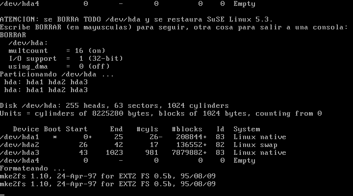
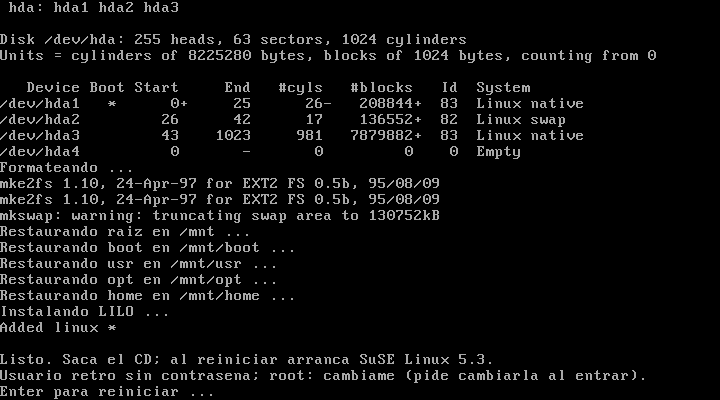
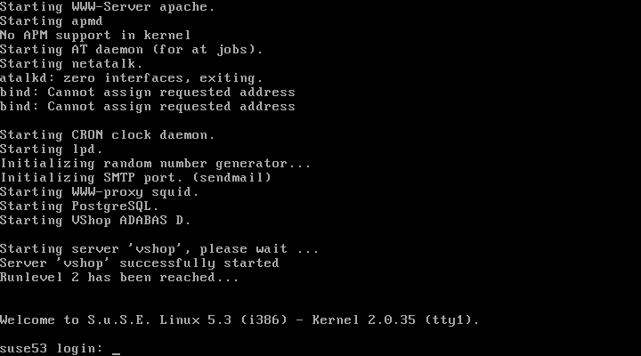
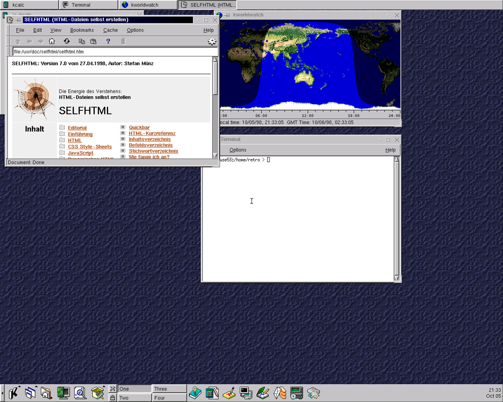

# Restaurador de SuSE Linux 5.3 (CD que instala un sistema ya instalado)

Un CD de arranque que copia una instalación de **SuSE Linux 5.3 ya hecha** (con `xf86vesa` configurado, KDE,
la base RPM…) a un disco IDE, **sin pasar por YaST**. Útil en PCs donde la instalación normal falla (por ejemplo,
máquinas x86-64 donde el instalador de 1998 se queja del CPU): ya instalado, el sistema arranca.

**No incluye ningún sistema**: cada quien empaqueta el suyo con `hacer_tgz.sh`. Necesitas tu propio CD/ISO de
SuSE Linux 5.3 (de ahí salen `isolinux.bin` y el kernel de instalación 2.0.35) — en el script se toma de un ISO con
el arrancador en `/boot/loader` (`isolinux.bin` y `linux53`); si tu CD es otro, ajusta esas dos rutas.

## Cómo funciona

1. Arranca ISOLINUX con el kernel de instalación de SuSE 5.3 (2.0.35, IDE/ATAPI incluidos) y un initrd propio.
2. El initrd (ext2 revisión 0) lleva las herramientas del mismo SuSE 5.3, con su libc5: `bash`, `sfdisk`, `mke2fs`,
   `mkswap`, `tar`, `gzip`, `lilo`, `ldconfig`. Su `linuxrc`:
   - busca el CD (el que tiene `/restaura/RESTAURA.ID`) y el primer disco IDE que no sea el CD (mínimo 4.6 GB);
   - pide escribir **BORRAR**;
   - activa en el disco escritura multisector y E/S de 32 bits con `hdparm` (y DMA si el controlador lo deja):
     en QEMU pasa de 32 a 96 MB por minuto;
   - particiona: `1` /boot 200 MB (activa), `2` swap 128 MB, `3` / el resto; formatea con el `mke2fs` de 1998;
   - extrae `raiz/boot/usr/opt/home.tgz.NN` (para o abre una consola si gzip o tar fallan);
   - escribe `fstab` y `lilo.conf` (kernel copiado a `/boot`, `linear`), instala LILO en el MBR y reinicia.

## La prueba (QEMU, disco IDE de 8 GB)

| | |
|---|---|
|  |  |
|  |  |

## Armarlo

```sh
# 1. monta tu instalación (raiz, boot, usr, opt, home) en solo lectura y empaquétala
sudo bash hacer_tgz.sh /mnt/mi-suse53 ./tgz
# 2. arma el ISO: herramientas del initrd desde tu /, arranque desde tu ISO de SuSE 5.3
sudo bash armar_restaurador.sh /mnt/mi-suse53/raiz suse53.iso ./tgz suse53-restaurador.iso
```

Necesita en la máquina que arma: `genisoimage`, `isoinfo`, `mke2fs` (e2fsprogs moderno, con `-E revision=0`),
`gzip`/`pigz`, `split`.

## Lo que aprendimos (Linux 2.0)

- **«Warning: defective cdrom. Enabling cruft»**: el iso9660 de 2.0 trata un archivo de más de 700 MB como CD dañado y
  recorta todos los tamaños a 24 bits (16 MB). Por eso los tgz van en pedazos de 600 MB.
- El ISOLINUX 1.62 de los CDs de la época busca sus archivos en el directorio de `isolinux.bin`: aquí `/boot/loader`.
- `mke2fs` moderno hace ext2 que 2.0 no lee: el initrd va en **revisión 0** (inodos de 128 bytes, sin extras).
- **SATA**: Linux 2.0 no lo conoce. En el BIOS, modo SATA = IDE / Legacy / Compatible.
- En PIO (sin DMA) y de a un sector, formatear 7.5 GB tarda ~25 minutos; con `hdparm -m16 -c1` va tres veces más rápido.
- `gzip` puede salir con 141 (SIGPIPE) cuando `tar` ya leyó el fin del archivo y cerró antes: no es error.

Licencia: MIT/X11, como el resto del repo. Probado en QEMU (Proxmox) con un disco IDE de 8 GB.
